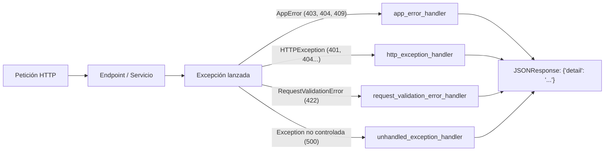

# SGR-49 — Manejo Centralizado de Errores

## Propósito

Proporcionar un manejo centralizado de errores para **Ratatouille ERP** (historia **SGR-10** y subtareas **SGR-49**, **SGR-50** y **SGR-51**) que devuelva mensajes claros en español con un único formato JSON (`{"detail": "..."}`), identifique el campo erróneo en las validaciones `422` y oculte detalles internos ante errores `500`.

## Flujo de Arquitectura



## Clases de Excepción (`app/core/exceptions.py`)

- `AppError(Exception)`: Clase base para errores de negocio de la aplicación.
- `NotFoundError(AppError)`: Recurso inexistente (`404`).
- `ConflictError(AppError)`: Conflicto con el estado actual o duplicado (`409`).
- `PermissionDeniedError(AppError)`: Falta de permisos para la operación (`403`).

## Códigos de Estado HTTP Soportados

| Código HTTP | Origen | Comportamiento |
| :---: | :--- | :--- |
| `401` | `HTTPException(401)` | Traduce mensajes por defecto al español (`"No autenticado"`) y preserva la cabecera `WWW-Authenticate`. |
| `403` | `PermissionDeniedError` / `HTTPException(403)` | Devuelve el motivo de falta de permisos en español. |
| `404` | `NotFoundError` / `HTTPException(404)` | Indica que el recurso o ruta solicitada no existe. |
| `409` | `ConflictError` / `HTTPException(409)` | Informa de un conflicto de negocio o duplicidad en español. |
| `422` | `RequestValidationError` | Indica el campo erróneo y el motivo traducido mediante `PYDANTIC_SPANISH_MESSAGES`. |
| `500` | `Exception` (no controlada) | Registra el error con `logging` y devuelve `"Error interno del servidor"`. |

## Ejemplos de Respuesta JSON (`ErrorResponse`)

**Error de dominio o HTTP (`404 Not Found`):**
```json
{
  "detail": "Plato no encontrado"
}
```

**Error de validación (`422 Unprocessable Content`):**
```json
{
  "detail": "Error en el campo 'nombre': El campo es obligatorio"
}
```

## Ejecución de Pruebas

```bash
pytest -v
```
